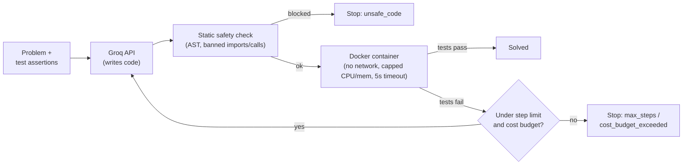

# Sandboxed Coding Agent

[](https://github.com/erbolboribaev/sandboxed-coder/actions)


An LLM agent that writes Python code to solve a problem, runs it inside an isolated Docker container, and retries with the actual error fed back to the model -- all bounded by hard guardrails (step limit, cost budget, a static safety check, and real sandboxing) so it can't loop forever, overspend, or execute something dangerous.

Benchmarked on 20 LeetCode-style problems: **20/20 solved, 100%, total cost $0.0022.**

## What it does

1. You give the agent a problem statement and a set of test assertions.
2. It asks an LLM (Groq, `openai/gpt-oss-20b`) to write a Python function solving it.
3. Before running anything, a static AST check rejects obviously dangerous code (`os`, `subprocess`, `socket`, `eval`, `open`, etc.) -- defense in depth, not the primary guard.
4. The code runs inside a Docker container with no network access, capped memory/CPU, and a 5-second timeout.
5. If the tests fail, the actual error output is fed back to the model for another attempt -- up to a hard step limit (default 5) and cost budget (default $0.50), whichever comes first.
6. Every step is logged as one JSON line for later analysis.

## Architecture



## Results

| Metric | Value |
|---|---|
| Benchmark success rate | 20/20 (100%) |
| Problems solved on first try | 20/20 |
| Total benchmark cost | $0.0022 |
| Tests | 18 passing (pytest + CI) |
| Problem difficulty spread | 4 Easy, 12 Medium, 4 Hard (LeetCode's own labels) |

**Honest caveat:** every problem here is a well-known, canonical algorithm problem (Two Sum, 3Sum, Trapping Rain Water, Regex Matching, etc.) that a model this capable has almost certainly seen many times during training. A 100% first-try rate says the agent's happy path works reliably -- it does not mean the retry loop is rarely needed in general. The retry/guardrail logic itself is verified independently and rigorously by the unit tests (`tests/test_agent.py`), which simulate failures deterministically rather than hoping a live model happens to get something wrong.

<details>
<summary>Full per-problem benchmark output</summary>
[SOLVED] climbing_stairs steps=1 cost=$0.0001 3.4s (solved)
[SOLVED] coin_change steps=1 cost=$0.0001 1.6s (solved)
[SOLVED] group_anagrams steps=1 cost=$0.0001 1.5s (solved)
[SOLVED] longest_common_subsequence steps=1 cost=$0.0001 1.6s (solved)
[SOLVED] longest_substring steps=1 cost=$0.0001 1.4s (solved)
[SOLVED] longest_valid_parentheses steps=1 cost=$0.0001 1.3s (solved)
[SOLVED] max_subarray steps=1 cost=$0.0001 1.4s (solved)
[SOLVED] median_two_sorted_arrays steps=1 cost=$0.0002 1.8s (solved)
[SOLVED] merge_intervals steps=1 cost=$0.0001 1.5s (solved)
[SOLVED] product_except_self steps=1 cost=$0.0001 1.4s (solved)
[SOLVED] regex_match steps=1 cost=$0.0002 1.9s (solved)
[SOLVED] reverse_integer steps=1 cost=$0.0002 1.8s (solved)
[SOLVED] search_rotated_sorted_array steps=1 cost=$0.0001 1.3s (solved)
[SOLVED] three_sum steps=1 cost=$0.0001 1.4s (solved)
[SOLVED] top_k_frequent steps=1 cost=$0.0001 1.7s (solved)
[SOLVED] trapping_rain_water steps=1 cost=$0.0001 1.7s (solved)
[SOLVED] two_sum steps=1 cost=$0.0001 1.6s (solved)
[SOLVED] valid_anagram steps=1 cost=$0.0001 1.6s (solved)
[SOLVED] valid_parentheses steps=1 cost=$0.0001 1.4s (solved)
[SOLVED] word_break steps=1 cost=$0.0001 1.6s (solved)

Success rate: 20/20 (100%)
Avg steps to solve: 1.0 (solved on first try: 20/20)
Total cost: $0.0022

</details>

## Tech stack

| Layer | Choice |
|---|---|
| LLM | Groq API (`openai/gpt-oss-20b`) |
| Sandboxing | Docker (network disabled, memory/CPU capped) |
| Safety | AST-based static check (defense in depth) + Docker isolation (the real guard) |
| Testing | pytest, with the LLM and sandbox fully mocked (no API key or Docker needed in CI) |
| CI/CD | GitHub Actions |

## Quickstart

```bash
git clone https://github.com/erbolboribaev/sandboxed-coder.git
cd sandboxed-coder
python -m venv venv && venv\Scripts\activate   # or source venv/bin/activate on Linux/Mac
pip install -r requirements.txt
cp .env.example .env   # add your free Groq API key: console.groq.com/keys
python scripts/docker_smoke_test.py   # confirms Docker sandboxing works, costs nothing
python -m src.cli --problem problems/two_sum.json
```

Run the full benchmark:

```bash
python scripts/generate_problems.py
python scripts/run_benchmark.py
```

## Project structure

```
sandboxed-coder/
├── src/
│   ├── llm_client.py        # Groq wrapper: prompt -> code, with cost tracking
│   ├── safety_check.py      # AST-based banned import/call check
│   ├── sandbox.py           # Docker execution: isolation + timeout + resilience
│   ├── agent.py             # the iteration loop + guardrails
│   └── cli.py               # solve one problem from the command line
├── scripts/
│   ├── docker_smoke_test.py # verify sandboxing works, no API calls
│   ├── generate_problems.py # writes the benchmark problem set
│   └── run_benchmark.py     # runs the agent over every problem, reports results
├── problems/                # 20 benchmark problems (JSON: name, problem, test_code)
├── tests/                   # pytest suite (LLM + sandbox mocked)
├── .github/workflows/ci.yml # GitHub Actions: runs pytest
├── .env.example             # template for GROQ_API_KEY
├── .gitignore
├── requirements.txt
└── README.md
```

`logs/` is created at runtime (agent JSONL logs and `benchmark_results.json`) and is not committed.

## Technical decisions

**Guardrails live in the agent loop, not the LLM prompt.** The model is *asked* to write safe, correct code, but step limits, cost budgets, and the safety check are enforced in Python regardless of what the model does. A prompt is a request; code is a guarantee.

**The static safety check is defense in depth, not the real guard.** `safety_check.py` rejects obvious danger signs (`import os`, `eval`, etc.) before code ever reaches the sandbox, so unsafe code fails fast with a clear reason. But the actual safety property comes from Docker: `network_disabled=True`, a memory/CPU cap, and a wall-clock timeout. Even code that somehow slipped past the static check still can't reach the network or exhaust host resources.

**`docker.errors.DockerException` is caught and returned as a failed run, not raised.** Found this the hard way: Docker becoming unreachable during a benchmark run crashed the whole process, and because results were only written at the very end, a crash at any point would have lost everything completed so far. From the agent's perspective, "the sandbox couldn't confirm this code works" is the same kind of failure whether the code was wrong or the infrastructure blipped -- so `sandbox.run()` now returns a normal failed `RunResult` either way, and the existing retry/failure path handles it without special-casing.

**Tests mock the LLM and the sandbox.** `tests/test_agent.py` injects fake `generate_fn`/`run_fn` functions to test the control flow (retry, step limit, cost limit, unsafe-code short-circuit) deterministically -- no real API call or Docker container needed. This is what actually runs in CI; the live benchmark (real Groq + real Docker) is a separate, manually-run integration check.

**Benchmark results save incrementally, after every problem.** A 20-problem run that crashes on problem 15 shouldn't lose problems 1-14. `scripts/run_benchmark.py` writes `logs/benchmark_results.json` after each problem, and does a Docker health check before starting so a fully-down Docker fails fast with a clear message instead of burning through 20 problems' worth of wasted LLM calls.

## Bugs found during development

1. **Windows named-pipe transport changes the timeout exception type.** Docker Desktop on Windows communicates over a named pipe, not TCP. On Windows, a client-side `container.wait(timeout=...)` that times out surfaced as `requests.exceptions.ConnectionError` (wrapping a `urllib3.ReadTimeoutError`) rather than the `requests.exceptions.ReadTimeout` I had expected -- I only observed this on Windows; other platforms may differ. `sandbox.py` catches both, since which one you get is a transport detail, not something callers should have to know.

2. **A smoke test that silently never tested what it claimed to.** The original Docker network-isolation check ran `socket.socket()` -- which only allocates a local object and never touches the network, so it "passed" regardless of whether isolation actually worked. Fixed by having the check attempt a real `.connect()`, which fails loudly (as it should) when network access is genuinely blocked.

3. **An unreachable Docker daemon crashed the entire benchmark run.** `sandbox.run()` originally let `docker.errors.DockerException` propagate uncaught, and `run_benchmark.py` only wrote results at the very end. So when Docker became unreachable, the whole script died with a raw traceback and nothing would have been saved. Fixed by catching the exception at the point of failure and treating it as an ordinary failed run (see Technical Decisions above), plus incremental result saving and a pre-flight Docker check as additional lines of defense.

## Testing

```bash
pytest tests/ -v
```

18 tests covering the safety check (banned imports/calls, syntax errors), the code-extraction parser, and the full agent control flow (first-try success, retry-then-solve, step-limit exhaustion, cost-budget exhaustion, unsafe-code short-circuit, timeout handling, and the Docker-unavailable regression).

## License

MIT
